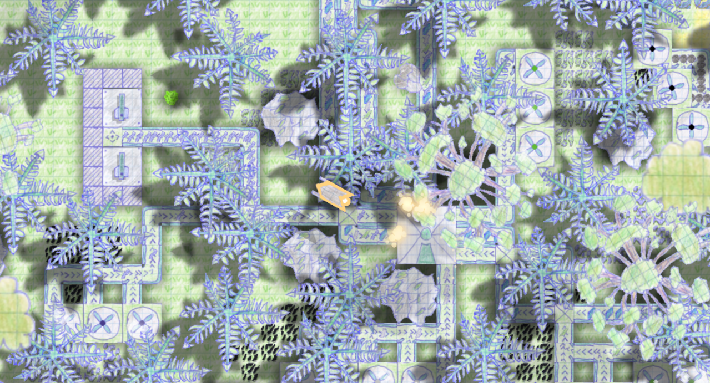
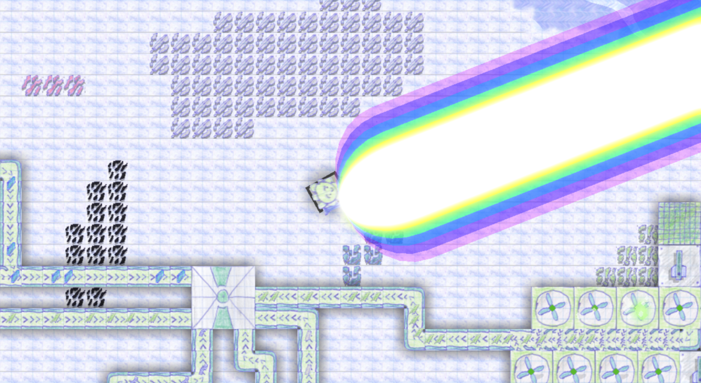

# ПУНЯ ПУНЯ ПУНЯ

  

---

## 📸 Скриншоты / Screenshots

  
  

  

## 🇷🇺 RUS: Описание мода

всем пруветь! это мой большой, сумашедший и *подозрительный* мод в который контент заталкивался ногами, пока папка мода не раздулась до 42 мегаБАЙТ (*бадам-тусс* скоро будет 50)

тут есть просто всякое, ещё больше всякого, ещё всякое и отдельные штуковины, которые взрываются прямо тебе в лицо (смотрим на тебя, вертолёт ПГВ-1, устраивающий локальный апокалипсис с морем кастомной жижи). половина штук ещё в процессе допила, так что стабильности не ждите.

**Кто такие Пуни?**
если вы думали, что Пуни — это какие-то непонятные монстры, то **неть**. Пуни — это супер милые маленькие осьминожки! =) Они настолько очаровательные, что вы захотите их поПУНЬКАТЬ *бадам-тусс*. правда их планету захватывают роботы и вы должны им помочь так что... удачи!

**⚠️ ВАЖНОЕ ОБЪЯВЛЕНИЕ:** 
это творение находится в состоянии «оно как бы работает, но лучше не дышать». если вы нашли баг, то просто создайте issue на Github и надейтесь что я его прочитаю. имейте в виду: если вы прибежите с криками «срочно почини!» — вы будете успешно проигнорированы. баги будут исправляться на моей волне и исключительно в моё личное время. 

я без понятия, это чистой воды произведение искусства, созданное в процессе долгого и упорного кодинга кем-то кто сходит с ума

## особые специальные очень важные интересные(нет) благодарности

этот мод вряд ли бы появился без идей, концептов и творчества людей, у которых я с уважением подсмотрел(или *любезно позаимствовал*) всё самое лучшее:

*   **[Anuken](https://github.com/Anuken)** — за создание *Mindustry*, великолепной документации и возможность создавать моды
*   **BYRIL LLC** — за их крутой блокнотный стиль графики.
*   **[LixieWulf](https://github.com/LixieWulf)** — за некотрые *необычные* идеи которые я использовал в своих целях
*   **[Sh1penfire](https://github.com/Sh1penfire)** — за кое-какое вдохновение в HJSON-инженерии
*   **[ItsKirby69](https://github.com/ItsKirby69)** — за идеи оформления окружения
*   **[FlinTyX](https://github.com/FlinTyX)** — за идею добавить животных(которые в итоге ничего не делают)
*   **[Catana791](https://github.com/Catana791)** — за кое-какие *подозрительные*(Astho**SUS** *бадам-тусс*) идеи
*   **[EyeOfDarkness](https://github.com/EyeOfDarkness)** — за идеи очень красивых(эпичных) vfx
*   **[MEEPofFaith](https://github.com/MEEPofFaith)** — за то что он вдохновил меня своими ядерками и летающими мечами
*   **Мой брат** — за то, что превратил наброски для треков *Boss 1*, *Land*, *Launch* и *Menu* в отличные саундтреки.

---

## 🇺🇸 ENG: Mod Description

**⚠️ WARNING:** my english is bad so you can make a pr to fix my dumb translation. im too lazy to fix this translation

Everyone, check it out! This is my big, crazy, and *suspicious* mod, where content was stuffed in by hand until the mod folder swelled to 42 MEGABYTES (*badam-tuss* will soon be 50).

There’s just all sorts of stuff here, even more stuff, even more stuff, and some weird things that explode right in your face (we’re looking at you, PGV‑1 helicopter, causing a local apocalypse with a sea of custom sludge). I've finished half of them in the process, so don't expect stability.

** Who are the Punies?**
if you thought that Punies were some kind of incomprehensible monsters, then ** none**. Puni are super cute little octopuses! =) They are so adorable that you will want to hug them. However, their planet is being invaded by robots and you have to help them, so... good luck!

**⚠️ IMPORTANT ANNOUNCEMENT:**
this creation is in a state of "it's kind of working, but it's better not to breathe." if you find a bug, just create an issue on Github and hope that I will read it. Keep in mind: if you come running shouting "fix it urgently!" you will be successfully ignored. bugs will be fixed on my wavelength and exclusively in my personal time. 

I have no idea, this is a pure work of art created in the process of long and hard coding by someone who is going insane.

## special special very important interesting (no) thanks

this mod would hardly have appeared without the ideas, concepts and creativity of people from whom I respectfully looked (or *kindly borrowed*) all the best:

*   **[Anuken](https://github.com/Anuken)** — for creating *Mindustry*, great documentation and the ability to create mods
* **BYRIL LLC** — for their cool notepad graphics style.
* **[LixieWulf](https://github.com/LixieWulf )** — for some *unusual* ideas that I used for my own purposes
* **[Sh1penfire](https://github.com/Sh1penfire )** — for some inspiration in HJSON engineering
*   **[ItsKirby69](https://github.com/ItsKirby69)** — for the ideas regarding the environment design
*   **[FlinTyX](https://github.com/FlinTyX)** — for the idea to add animals (which ultimately do nothing)
*   **[Catana791](https://github.com/Catana791)** — for some *suspicious* (Astho**SUS** *badam-tuss*) ideas
*   **[EyeOfDarkness](https://github.com/EyeOfDarkness)** — for the ideas behind very beautiful (epic) vfx
*   **[MEEPofFaith](https://github.com/MEEPofFaith)** — for inspiring me with his nukes and flying swords
*   **My brother** — for turning the sketches for the tracks *Boss 1*, *Land*, *Launch* and *Menu* into excellent soundtracks.

---

## установка / installation
1. скопируй ЭТО - `HamsterHat/OctDef` / copy THIS - `HamsterHat/OctDef`
2. Mindustry -> **Модификации (Mods)** -> **Импортировать модификацию (Import Mod)** -> **GitHub**
3. вставляй ссылку и надейся что игра не крашнется и Пуни не угонят твою ОЗУ / paste the link and hope that the game doesn't crash and the Punies don't steal your RAM.

